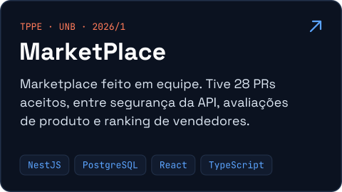
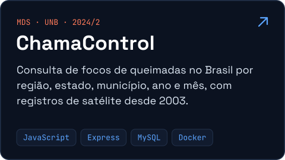
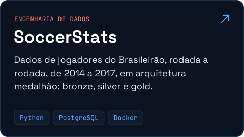
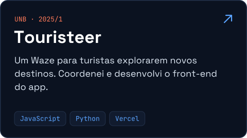
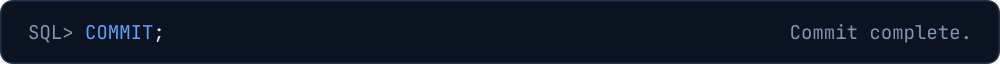

 

Sou o Leonardo, estudante do 8º semestre de Engenharia de Software na Universidade de Brasília (UnB). Trabalho no Tribunal de Contas da União (TCU) como desenvolvedor Oracle APEX e PL/SQL.

Fora do TCU, faço front-end com React, TypeScript e Astro. Na disciplina de TPPE, também trabalhei na API de um marketplace com NestJS e PostgreSQL.

## Stack

<table>
  <tr>
    <td><b>Banco e APEX</b> Oracle APEX, PL/SQL, PostgreSQL</td>
    <td> </td>
  </tr>
  <tr>
    <td><b>Front-end</b> Interfaces e sites</td>
    <td></td>
  </tr>
  <tr>
    <td><b>Back-end e linguagens</b> APIs, dados e algoritmos</td>
    <td></td>
  </tr>
  <tr>
    <td><b>Dia a dia</b> Versionamento e deploy</td>
    <td></td>
  </tr>
</table>

## Projetos

<b>Outros repositórios</b>

 

- [**ImobFlux**](https://github.com/leohssjr/imobflux): especificação e pitch, para o SEBRAE Supernova, de um sistema que gera contratos de locação e de compra e venda a partir de clientes e imóveis já cadastrados.
- [**LightUp-PDDLSolver**](https://github.com/leohssjr/LightUp-PDDLSolver): resolvedor em PDDL de mapas do jogo Light Up Akari, feito para a competição de Fundamentos Lógicos de Inteligência Artificial.
- [**Competição de Programação**](https://github.com/leohssjr/Competicao-de-Programacao): soluções em C e C++ para problemas do BeeCrowd e do Codeforces.
- [**SistemaCRUD**](https://github.com/leohssjr/SistemaCRUD): trabalho de Programação Orientada a Objetos em Java.

## No GitHub

  
  

## Contato

  
  
  

 

 COMMIT; Commit complete." />
